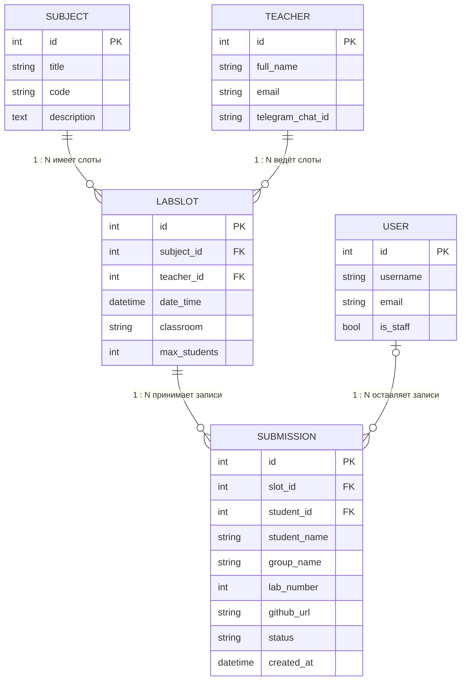
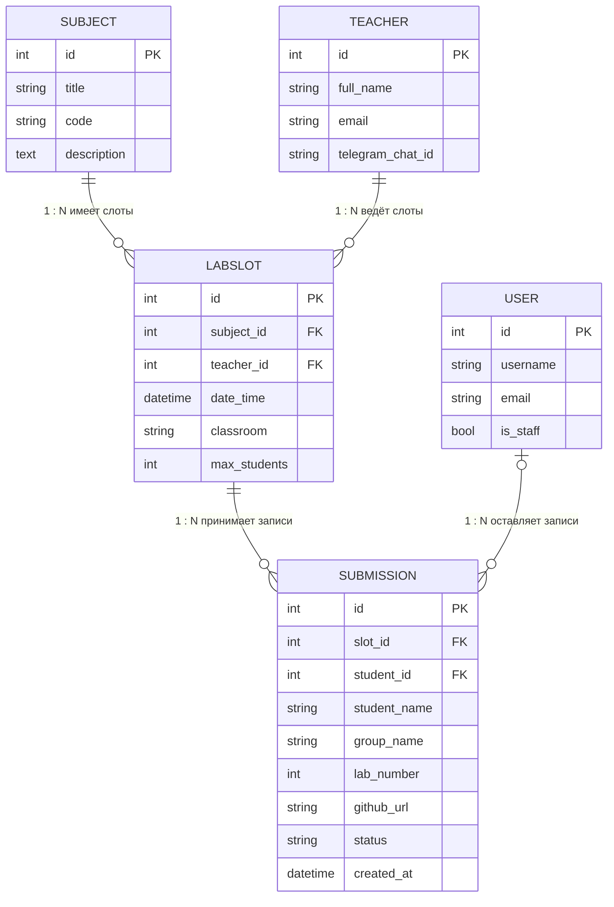

# LabQueue — запись на защиту лабораторных

Учебный веб-проект (СРС 1, «Разработка веб-приложений», КазНУ). Автор: Бекбала А.Е., группа: Компьютерная инженерия 23-03, курс: 4.
Преподаватель: Иманбек Р.К.

Сервис помогает записываться на слоты защиты лабораторных работ и вести учёт результатов:
преподаватель создаёт слоты, студент записывается и прикладывает ссылку на репозиторий,
преподаватель выставляет статус («Ожидает защиты», «Зачтено», «На доработку»).

## Возможности

- Регистрация, вход и выход (встроенный `django.contrib.auth`, свои страницы и формы).
- Две роли: **студент** и **преподаватель** (`is_staff`).
- Слоты: просмотр с фильтром по дисциплине; создание, редактирование, удаление — только преподаватель.
- Записи на защиту: полный CRUD. Студент видит и правит только свои записи, преподаватель — все и меняет статус.
- Серверная валидация: лимит мест, ссылка только на github.com / gitlab.com, номер лабы 1–20,
  ФИО из двух слов, запрет дубля записи, запрет слота в прошлом.
- Админ-панель Django для дисциплин и преподавателей.
- 16 автотестов.

## Запуск (Windows, PowerShell)

```powershell
python -m venv .venv
.venv\Scripts\activate
pip install -r requirements.txt
python manage.py migrate
python manage.py seed_demo      # демо-данные и тестовые пользователи
python manage.py runserver
```

Открыть http://127.0.0.1:8000/

| Роль | Логин | Пароль |
|---|---|---|
| Преподаватель | `teacher` | `teacher12345` |
| Студент | `student` | `student12345` |

(Только для демонстрации. Секретный ключ берётся из переменной окружения `DJANGO_SECRET_KEY`.)

Тесты: `python manage.py test`

## Структура проекта

```
manage.py                 запуск команд Django
mysite/
  settings.py             настройки (БД SQLite, приложения, язык, часовой пояс, вход)
  urls.py                 корневые маршруты: /admin/ и include('main.urls')
main/
  models.py               модели = таблицы БД (ORM)
  migrations/             история схемы БД (0001_initial.py)
  forms.py                формы и серверная валидация
  views.py                логика обработки запросов (CRUD, права)
  urls.py                 маршруты приложения
  admin.py                регистрация моделей в админке
  tests.py                автотесты
  management/commands/seed_demo.py   демо-данные
  templates/main/         HTML-шаблоны (все наследуют base.html)
  static/main/css/        стили
docs/er-diagram.mmd       ER-диаграмма (Mermaid)
```

## Как работает запрос

`браузер → mysite/urls.py → main/urls.py → main/views.py → models.py (ORM → SQLite) → шаблон .html → ответ`

## ER-диаграмма



Исходный код диаграммы (Mermaid, он же в `docs/er-diagram.mmd`):



## Модель данных

- `Subject` 1—N `LabSlot`, `Teacher` 1—N `LabSlot`, `LabSlot` 1—N `Submission`, `User` 1—N `Submission`.
- Внешние ключи с `on_delete=CASCADE` (удаление слота удаляет записи на него);
  у `Submission.student` — `SET_NULL`, чтобы запись не терялась при удалении пользователя.
- Ограничения: `PositiveIntegerField` + `MinValueValidator`/`MaxValueValidator`, `choices` для статуса,
  `auto_now_add` для даты записи.
